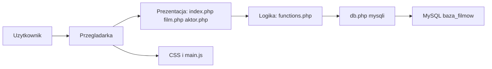
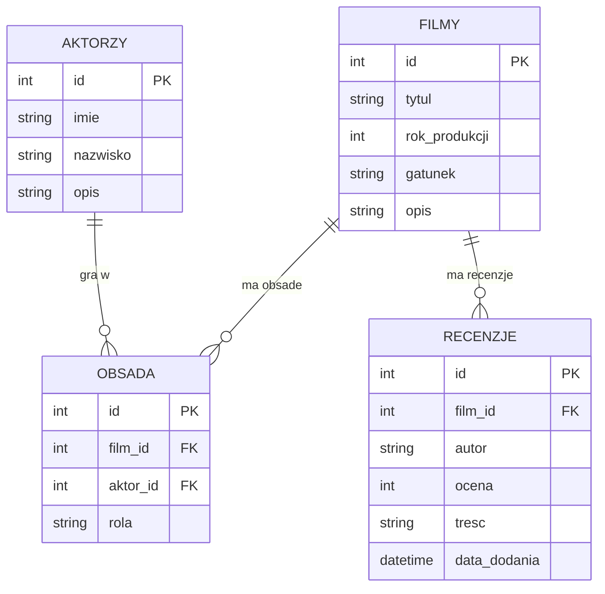

# Architektura — Baza Filmów

## Model trójwarstwowy

Aplikacja nie używa frameworka. Podział na warstwy jest widoczny w katalogach i w kierunku wywołań.

**Warstwa prezentacji** to trzy strony wejściowe oraz pliki statyczne. `index.php` renderuje katalog i formularze dopisywania danych. `film.php` renderuje jeden film. `aktor.php` renderuje jeden profil. Wygląd jest w `frontend/css/style.css`, a sprawdzenie formularza recenzji przed wysłaniem jest w `frontend/js/main.js`. Strony nie składają zapytań SQL samodzielnie.

**Warstwa logiki** to `backend/includes/functions.php`. Tutaj są odczyty katalogu, szczegółów, obsady i filmografii, walidacja pól oraz funkcje zapisu. Ta sama warstwa dokleja wspólny nagłówek i stopkę, żeby trzy strony miały jedno menu i jeden sposób kodowania UTF-8. Skrypty stron zostawiają sobie decyzję o przekierowaniu: funkcja zapisu zwraca `true` albo komunikat błędu, a `index.php` i `film.php` wysyłają `header('Location: ...')` tylko po sukcesie.

**Warstwa danych** to MySQL, baza `baza_filmow`. Połączenie otwiera `backend/config/db.php` (mysqli, `utf8mb4`, tryb wyjątków). Zapytania używają przygotowanych instrukcji. Średnia ocen powstaje w SQL, a nie w pętli PHP, dzięki czemu katalog nie dociąga wszystkich recenzji do pamięci skryptu.

Przepływ odczytu: przeglądarka → skrypt strony → funkcja logiki → prepared statement → InnoDB → tablica wierszy → `htmlspecialchars` → HTML.

Przepływ zapisu recenzji: przeglądarka (JS odcina pusty formularz i ocenę spoza 1–10) → POST → walidacja PHP → `INSERT` → `Location: film.php?id=X&status=recenzja` → GET, który maluje już nową listę. Odświeżenie dotyczy adresu GET.

## Baza danych

Cztery tabele pokrywają katalog, ludzi, związek wiele-do-wielu i opinie.

- `filmy` trzyma tytuł, rok, gatunek i opis. Jeden film ma wiele ról i wiele recenzji.
- `aktorzy` trzyma imię, nazwisko i notkę. Jeden aktor może zagrać w wielu filmach.
- `obsada` jest tabelą łączącą. Wiersz mówi, że konkretny aktor gra konkretną rolę w konkretnym filmie. Para film–aktor może wystąpić wielokrotnie tylko wtedy, gdy nazwa roli jest inna (`UNIQUE` po trzech kolumnach).
- `recenzje` należy do jednego filmu. Kolumna `ocena` jest typu `INT` i ma ograniczenie `CHECK (ocena BETWEEN 1 AND 10)`. `data_dodania` dostaje `CURRENT_TIMESTAMP`, jeśli aplikacja jej nie poda.

Klucze obce `fk_obsada_film`, `fk_obsada_aktor` i `fk_recenzje_film` mają `ON DELETE CASCADE` oraz `ON UPDATE CASCADE`. Usunięcie filmu w phpMyAdmin usuwa jego obsadę i recenzje. Usunięcie aktora usuwa jego role, ale nie filmy.

Odczyt obsady używa `INNER JOIN`, bo rola bez aktora nie ma sensu. Odczyt katalogu używa `LEFT JOIN` do recenzji, bo film bez opinii nadal ma być na liście, a `AVG` ma wtedy zwrócić `NULL` (w interfejsie: „Brak ocen”).

## Decyzje, które trzymają kod w ryzach

Strony wejściowe są w katalogu głównym projektu, a nie w `frontend/`, bo Apache w XAMPP serwuje `htdocs/MovieDatabase` jako korzeń aplikacji. Dzięki temu adresy `film.php?id=1` i `aktor.php?id=2` są krótkie i zgodne z poleceniem.

Wspólne elementy HTML są funkcjami `naglowek()` i `stopka()`, a nie osobnym plikiem spoza ustalonej listy. Logika SQL nie jest kopiowana między stronami.

Błędy połączenia nie wypisują hasła ani treści wyjątku do przeglądarki. Użytkownik dostaje krótką informację, że MySQL ma działać i że plik `database/schema.sql` ma być zaimportowany.
