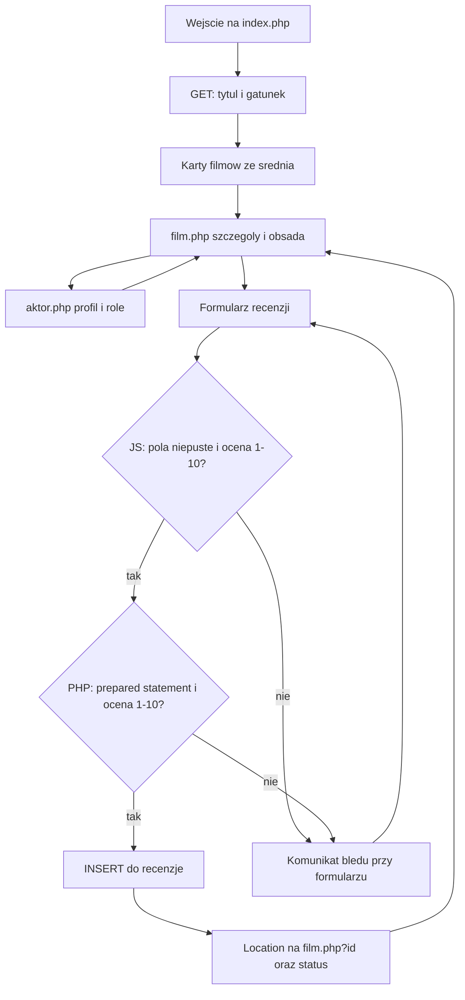
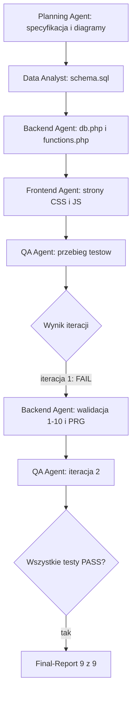

# Przepływ pracy — Baza Filmów

## Przeglądanie filmu i dodanie recenzji

Użytkownik zaczyna w katalogu. Wyszukiwarka dokleja do adresu `tytul` i `gatunek`, więc wynik da się skopiować albo odświeżyć bez ponownego wysyłania formularza. Z karty przechodzi do filmu. Stamtąd może zejść do profilu aktora i wrócić albo zostać przy recenzjach.

Formularz recenzji ma atrybut `novalidate`, żeby kontrolę zakresu pokazał własny skrypt, a nie wyłącznie wbudowany komunikat przeglądarki. Skrypt sprawdza puste pola i całkowitą ocenę od 1 do 10. To nie zastępuje serwera: PHP powtarza te warunki, bo żądanie da się wysłać z pominięciem JavaScript.

Gdy zapis się uda, odpowiedź nie jest stroną wyrenderowaną na POST. Jest przekierowaniem na adres filmu ze `status=recenzja`. Kolejne F5 powtarza GET. Wpis powstaje raz.

Dodanie filmu, aktora i roli idzie tą samą ścieżką PRG, tylko zostaje na `index.php` i rozróżnia sukces parametrami `status=film`, `status=aktor` albo `status=obsada`.

## Praca agentów i pętla QA

Planning Agent spisał zakres i kryteria, zanim powstały tabele. Data Analyst oddał model i dane. Backend Agent podłączył PHP do MySQL i wystawił funkcje. Frontend Agent złożył na tym karty, formularze i walidację w przeglądarce.

QA Agent nie kończy pracy przy pierwszym przejściu. W iteracji 1 dwie usterki wróciły do Backend Agenta: serwer przyjmował ocenę spoza skali 1–10, gdy żądanie omijało przeglądarkę, a odpowiedź na POST renderowała formularz ponownie, więc F5 potrafiło wysłać recenzję drugi raz. Po poprawce (walidacja w `zapiszRecenzje()` oraz `header('Location: ...')`) QA powtórzył zestaw. Iteracja 2 zamknęła się statusem PASS.

