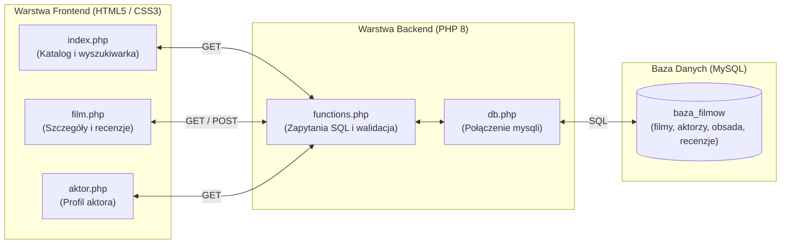
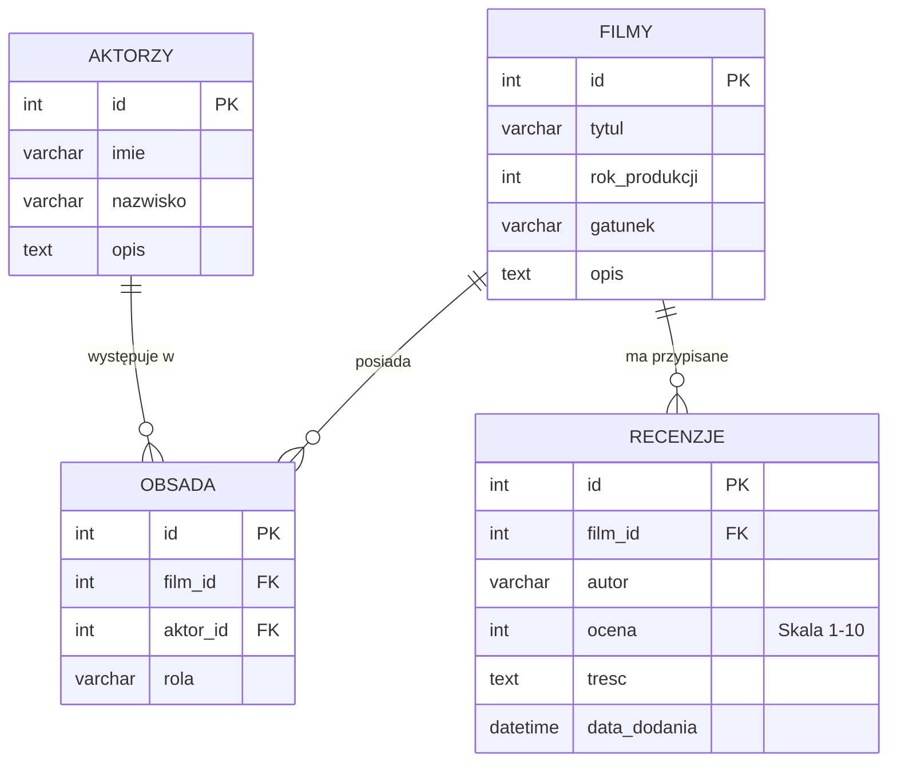
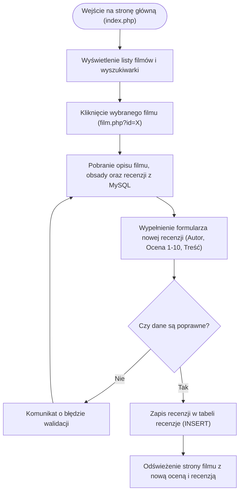

# Raport Projektowy i Diagramy — Aplikacja "Baza Filmów" (INF.03)

## 1. Cel i opis projektu
Projekt polega na stworzeniu aplikacji internetowej **Baza Filmów (MovieDatabase)** w technologiach **PHP**, **MySQL**, **HTML5** oraz **CSS3** przy wykorzystaniu zespołu wyspecjalizowanych agentów AI zarządzanych przez ucznia (Kierownika Projektu).

**Główne funkcjonalności aplikacji:**
- **Katalog filmów (`index.php`):** Wyświetlanie listy filmów (tytuł, rok produkcji, gatunek, opis, średnia ocen) oraz wyszukiwarka po tytule i gatunku.
- **Szczegóły filmu i recenzje (`film.php`):** Widok opisu filmu, listy przypisanych aktorów (obsada) oraz sekcja recenzji z formularzem dodawania nowej oceny w skali 1–10.
- **Baza aktorów (`aktor.php`):** Informacje o aktorze wraz z listą filmów, w których wystąpił.

---

## 2. Podział pracy pomiędzy agentów AI

| Agent AI | Rola w projekcie | Efekty pracy (Pliki) |
| :--- | :--- | :--- |
| **Planning Agent** | Analiza wymagań, przygotowanie specyfikacji projektu oraz diagramów Mermaid. | `Docs/Specs.md`, `Docs/Architecture.md`, `Docs/Workflow.md`, `Docs/Sessions/Planning.md` |
| **Data Analyst (DA)** | Projekt relacyjnej bazy danych MySQL (4 tabele, klucze obce) oraz danych testowych. | `database/schema.sql`, `Docs/Sessions/DataAnalyst.md` |
| **Backend Agent (BE)** | Logika w PHP, połączenie z bazą MySQL, obsługa wyszukiwarki i formularza recenzji. | `backend/config/db.php`, `backend/includes/functions.php`, `Docs/Sessions/Backend.md` |
| **Frontend Agent (FE)** | Przygotowanie widoków HTML5, stylizacji CSS3 oraz walidacji formularzy. | `index.php`, `film.php`, `aktor.php`, `frontend/css/style.css`, `Docs/Sessions/Frontend.md` |
| **QA Agent** | Testy działania aplikacji, wykrycie błędów walidacji, weryfikacja poprawek. | `Docs/QA-Report.md`, `Docs/Sessions/QA.md` |

---

## 3. Diagram Architektury Aplikacji

---

## 4. Diagram Bazy Danych (ERD)
Baza danych składa się z 4 tabel. Tabela `obsada` realizuje relację wiele-do-wielu (`M:N`) pomiędzy tabelami `filmy` i `aktorzy`, natomiast tabela `recenzje` jest powiązana z tabelą `filmy` relacją jeden-do-wielu (`1:N`).

---

## 5. Diagram Przepływu Działania (Workflow użytkownika)

---

## 6. Przebieg testów (QA) i napotkane problemy
W trakcie realizacji projektu **QA Agent** przeprowadził dwie tury testów:
1. **Iteracja 1 (Wykrycie błędów):**
   - **Problem 1:** Brak walidacji skali ocen 1–10 po stronie PHP (możliwość wpisania liczby spoza skali).
   - **Problem 2:** Odświeżenie strony klawiszem F5 po dodaniu recenzji powodowało ponowne wysłanie tego samego formularza.
   - **Problem 3:** Dla filmów bez żadnej recenzji średnia ocen wyświetlała puste pole (`NULL`).
2. **Wprowadzone poprawki (Backend Agent):**
   - Dodano sprawdzanie warunku `$ocena >= 1 &&$ocena <= 10` w PHP.
   - Wdrożono przekierowanie `header("Location: film.php?id=...")` po zapisie recenzji (wzorzec PRG).
   - Dodano obsługę komunikatu *"Brak ocen"* dla filmów bez recenzji.
3. **Iteracja 2 (Akceptacja):** Wszystkie testy zakończyły się statusem **PASS**.

---

## 7. Podsumowanie i realizacja kryteriów (9/9)
- [x] Aplikacja uruchamia się lokalnie i łączy z MySQL
- [x] Wyświetla listę filmów i szczegóły wybranego filmu
- [x] Pokazuje aktorów przypisanych do filmów
- [x] Wyświetla i zapisuje recenzje
- [x] Dane są przechowywane w relacyjnej bazie danych
- [x] Powstały Specs i diagramy Mermaid
- [x] Agenci mają zdefiniowane role i zapisane podsumowania sesji
- [x] QA przeprowadził testy i zweryfikował poprawki
- [x] Przygotowano sprawozdanie końcowe
